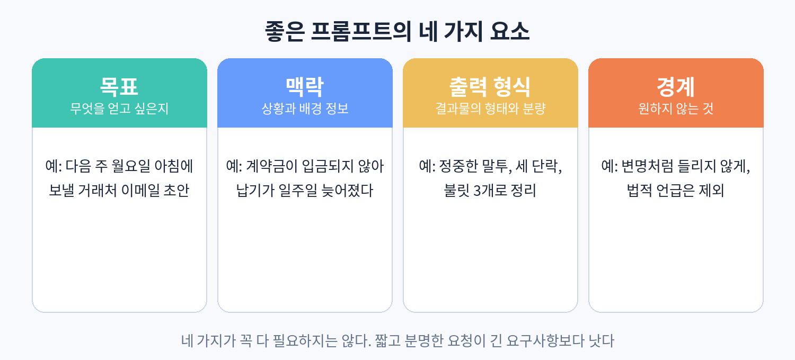

# 20. 결과부터 말하라: 좋은 프롬프트의 네 가지 요소

프롬프트는 ChatGPT에게 일을 시키는 지시문이다. OpenAI가 공개한 프롬프트 가이드에 따르면, 좋은 프롬프트는 네 가지 요소를 갖는다. 목표, 맥락, 출력 형식, 경계다. 네 가지가 꼭 다 들어가야 하는 것은 아니다. 짧고 분명한 요청이 길고 모호한 요구사항보다 낫다. 이 네 가지는 체크리스트가 아니라, 답이 별로일 때 점검해 볼 항목 목록이다.

### 요소 1. 목표: 무엇을 얻고 싶은지

가장 먼저, 결과물이 어떤 모습이어야 하는지를 말한다. "이메일 써줘"가 아니라 "다음 주 월요일 아침에 보낼 거래처 이메일 초안"처럼 말한다. 가이드의 핵심 조언은 이것이다. 과정을 지시하지 말고 결과를 설명하라. "먼저 문서를 읽고, 주제를 뽑고, 세 단락으로 써라" 같은 식으로 절차를 나열하면 모델의 판단 여지가 사라지고, 정작 원하는 결과에서 멀어질 수 있다. 절차가 법적으로 중요한 경우에만 과정을 지정하고, 나머지는 결과의 모습을 말하면 된다.

### 요소 2. 맥락: 상황과 배경 정보

ChatGPT는 내 상황을 모른다. "계약금이 입금되지 않아 납기가 일주일 늦어졌다" 같은 배경을 알려주면 답의 방향이 달라진다. 맥락은 길 필요 없다. 두세 줄이면 충분하다. 회의 안건이라면 회의의 목적과 참석자를, 보고서라면 보고 라인과 독자를 알려준다. 내 가게나 팀을 모르는 AI에게 내 상황을 알려주는 것이 맥락이다.

### 요소 3. 출력 형식: 결과물의 형태와 분량

형식을 정해주지 않으면 ChatGPT는 알아서 형식을 고른다. 그게 마음에 안 들 확률이 높다. "정중한 말투, 세 단락, 불릿 세 개로 정리"처럼 형태를 지정하자. 표로 받을지, 문단으로 받을지, 몇 자 내외로 받을지를 말한다. 보고서라면 "배경, 현황, 제안을 각각 한 단락씩"처럼 구조를 정해주면 초안의 품질이 확 올라간다.

### 요소 4. 경계: 원하지 않는 것

하지 말아야 할 것도 분명히 말한다. "변명처럼 들리지 않게", "법적 언급은 제외", "전문 용어는 풀어서" 같은 식이다. 경계는 특히 회사 글쓰기에서 중요하다. 하지 말라는 것을 안 말하면, 나중에 지우는 수고를 하게 된다.

### 실습

어제 썼거나 이번 주에 써야 하는 실제 이메일 한 건을 골라, 네 가지 요소를 채워 프롬프트를 만들어 보자. 목표 한 줄, 맥락 두 줄, 출력 형식 한 줄, 경계 한 줄. 다섯 줄짜리 프롬프트로 나온 답과 원래 쓰려던 답을 비교해 보자.
