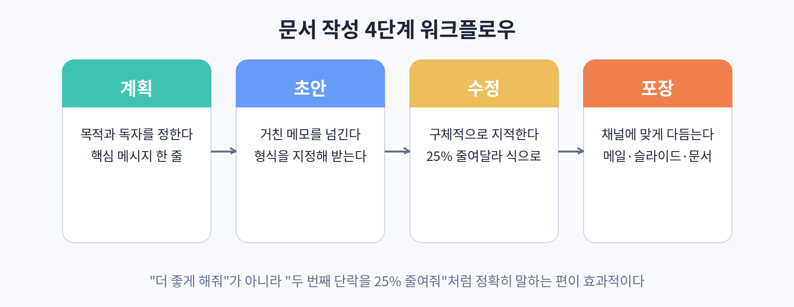

# 30. 이메일 쓰기와 답장

직장인의 하루는 이메일로 시작해서 이메일로 끝난다. ChatGPT가 가장 시간을 아껴주는 곳도 이메일이다. 이메일 쓰기에는 정형화된 흐름이 있다. 용건을 정리하고, 말투를 정하고, 초안을 쓰고, 다듬는다. 이 중 두 번째와 세 번째를 AI에게 맡기면 된다.

### 이메일 쓰기의 4단계 흐름

이 흐름은 이메일뿐 아니라 보고서와 기획서에도 그대로 적용된다. 계획 단계에서는 이메일을 왜 쓰는지, 받는 사람이 누구인지를 정한다. 초안 단계에서는 거친 메모를 ChatGPT에 넘기고 형식을 지정해 받는다. 수정 단계에서는 구체적으로 지적하며 다듬는다. 포장 단계에서는 제목과 서명을 붙여 발송 형태로 만든다.

### 초안을 뽑는 프롬프트

실제로 써보자. 거래처에 납기 지연을 알리는 이메일이 필요하다고 하자. 메모는 이렇게 거칠어도 된다. "계약금 미입금, 납기 1주 지연, 다음 주 금요일 납품 가능, 양해 부탁". 이 메모를 이렇게 넘긴다.

"너는 우리 회사 영업팀 대리다. 아래 메모를 바탕으로 거래처 담당자에게 보낼 이메일 초안을 써줘. 정중한 말투로, 세 단락으로. 변명처럼 들리지 않게 쓰고, 법적 언급은 제외해줘. 메모: 계약금 미입금으로 납기가 1주일 늦어졌다. 다음 주 금요일 납품 가능하다."

이 정도면 바로 쓸 수 있는 초안이 나온다. 제목도 함께 부탁하면 좋다. "제목 세 가지 후보도 같이 줘" 한 줄이면 된다.

### 답장 쓰기

받은 메일에 답할 때는 원문을 붙여 넣고 이렇게 말한다. "아래 메일에 대한 답장을 써줘. 수락하되, 미팅 시간은 다음 주 화요일 오후로 조정해 달라고 요청해줘." 원문이 길면 "이 메일의 핵심 요청 세 가지를 먼저 정리해 줘"라고 한 뒤, 각 항목에 대한 답변 방향을 말해주면 답장 초안이 훨씬 정확해진다.

### 실습

이번 주에 보내야 하는 실제 이메일 한 통을 골라, 거친 메모 세 줄을 쓴 뒤 위 형식으로 초안을 뽑아 보자. 제목 후보 세 가지도 함께 받아 보자.
