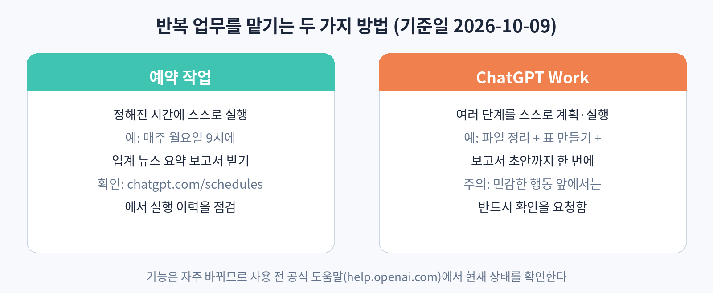

# 53. 예약 작업과 ChatGPT Work

매일, 매주 반복되는 일을 ChatGPT가 알아서 해주는 기능이 있다. 아침마다 뉴스를 요약해 주고, 매주 월요일에 보고서를 만들어 두는 식이다. 기준일 현재 이 영역은 변화가 빠르니, 이 장의 내용은 개념 위주로 읽고 실제 버튼 위치는 공식 도움말에서 확인하자.

### 예약 작업: 정해진 시간에 스스로 실행

예약 작업은 "매주 월요일 오전 9시에 우리 업계 뉴스를 요약해 줘"처럼 시간과 일을 정해두면, 그 시간이 되면 ChatGPT가 스스로 실행하는 기능이다. 실행 결과는 대화창에 쌓인다. 출근하면 밤사이 만들어진 요약이 와 있는 식이다.

예약 작업을 만들 때는 이렇게 구체적으로 말한다. "매일 오전 8시에 전날의 IT 업계 주요 뉴스를 다섯 개 요약해 줘. 각 뉴스는 한 줄 요약과 출처 링크를 붙여줘." 실행 이력은 예약 작업 관리 화면에서 확인할 수 있다. 결과가 이상하면 조건을 고치거나 예약을 끈다. 처음에는 일주일만 시험 운영해 보고, 쓸 만하면 계속 쓰는 것이 좋다.

예약 작업에 맡기기 좋은 일은 세 가지 조건을 만족한다. 정해진 시간에, 정해진 형식으로, 내가 확인만 하면 되는 일이다. 뉴스 요약, 주간 매출 집계, 경쟁사 SNS 모니터링 같은 일이다. 반대로 판단이 필요한 일이나 실수가 치명적인 일은 맡기지 않는다. 예약 작업의 결과는 내가 확인하고 쓰는 것이 원칙이다.

### ChatGPT Work: 여러 단계를 한 번에

ChatGPT Work는 긴 일을 통째로 맡기는 에이전트 기능이다. "이번 달 매출 파일을 정리하고, 월별 표를 만들고, 보고서 초안까지 써줘"라고 하면 스스로 계획을 세워 순서대로 실행한다. 앱을 연결해 두면 캘린더나 이메일 같은 외부 정보도 가져올 수 있다.

Work의 특징은 두 가지다. 첫째, 계획을 먼저 보여준다. 실행 전에 어떤 순서로 할지를 제시하니, 이상하면 그때 고치면 된다. 둘째, 민감한 행동 앞에서는 확인을 요청한다. 메일을 보내거나 파일을 지우는 같은 행동은 네 허락 없이 하지 않는다. 이 확인 과정을 귀찮다고 끄지 말자. 자동화의 안전장치다.

### 실습

이번 주에 반복되는 일 하나를 골라 예약 작업으로 만들어 보자. 시간, 형식, 확인할 방법을 정하고 일주일 시험 운영을 시작한다. 일주일 뒤 결과를 보고 계속할지 판단해 보자.
