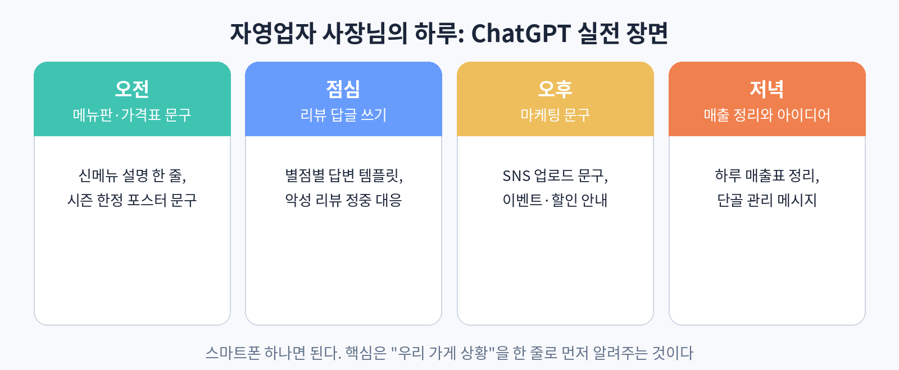

# 55. 관심 주제: 자영업자 사장님의 하루

이 장은 자영업자 사장님을 위한 챕터다. 컴퓨터 앞에 앉을 시간이 없는 사장님이 스마트폰 하나로 쓰는 ChatGPT 실전 장면을 시간대별로 정리했다. 검색 수요를 보면 "소상공인 AI 활용"에 대한 관심은 꾸준히 크고, 특히 "써봤는데 별로더라"는 실망 경험이 많다. 그 실망의 원인은 대부분 물어보는 방식에 있다. 이 장은 그 간극을 메운다.

### 오전: 메뉴판과 가격표 문구

신메뉴가 나왔는데 설명 문구가 막막하다면 이렇게 묻는다. "우리 가게는 동네 분식집이야. 30~40대 직장인이 점심에 많이 와. 신메뉴 '매콤 로제 떡볶이' 설명을 메뉴판에 쓸 한 줄로 써줘. 20자 이내로." 핵심은 첫 문장에 가게 상황을 알려주는 것이다. "메뉴 설명 써줘"라고만 하면 어떤 가게에도 붙일 수 있는 말이 나온다. 내 가게를 알려주면 내 가게 말이 나온다.

가격표나 포스터 문구도 같다. "가을 한정 메뉴 포스터에 쓸 문구 세 가지. '든든한 한 끼' 느낌으로." 시즌, 분위기, 분량을 정해주면 바로 쓸 수 있는 문구가 나온다.

### 점심: 리뷰 답글 쓰기

리뷰 답글은 손이 많이 가는 일이다. 별점별로 말투를 정해두면 편하다. "별점 5점 리뷰에는 감사 인사와 재방문 유도를, 3점 이하 리뷰에는 사과와 개선 약속을 담은 답글을 써줘. 우리 가게는 동네 카페야." 실제 리뷰 내용을 붙여 넣으면 그에 맞는 답글이 나온다.

악성 리뷰에도 원칙은 같다. 감정적으로 대응하지 말고, 정중하게 사실만 말한다. "이 리뷰에 대한 답글을 써줘. 감정적이지 않게, 사실관계만 정중하게. 우리 입장에서 억울한 부분은 '확인해 보겠다'는 표현으로." 답글을 보내기 전에는 꼭 한 번 읽어본다. AI가 쓴 답글도 사장님의 이름으로 나간다.

### 오후: 마케팅 문구와 SNS

인스타그램에 올릴 글도 ChatGPT가 돕는다. 사진을 찍은 뒤 "오늘 점심 특선 사진이야. 인스타에 올릴 글 3줄 써줘. 해시태그 5개도." 이벤트 문구도 마찬가지다. "이번 주말 10% 할인 이벤트 안내문을 써줘. 카톡으로 보낼 거야. 친근한 말투로." 채널에 맞는 말투를 지정하는 것이 요령이다. 카톡은 친근하게, 포스터는 단정하게.

### 저녁: 매출 정리와 단골 관리

하루 매출을 메모한 것을 넘기면 표로 정리해 준다. "오늘 매출 메모야. 표로 정리해줘. 현금, 카드 구분해서." 단골에게 보낼 메시지도 쓴다. "한 달 만에 온 단골에게 보낼 감사 메시지. 부담스럽지 않게." 작은 가게의 단골 관리는 이런 한 줄 메시지에서 시작된다.

### 사장님을 위한 세 가지 원칙

첫째, 스마트폰만으로 충분하다. 초안, 아이디어, 문장 만들기는 카톡 보내듯 하면 된다. 둘째, 내 가게 상황을 먼저 말한다. "우리 가게는 OOO이야" 한 줄이 답을 바꾼다. 셋째, 보내기 전에는 꼭 읽는다. AI가 쓴 글도 사장님의 얼굴이다.

### 실습

오늘 가게에서 실제로 필요한 문구 하나를 골라, "우리 가게는 OOO이야"로 시작하는 프롬프트를 만들어 보자. 메뉴 설명, 리뷰 답글, SNS 문구 중 하나면 된다.
